# Hướng dẫn nhập liệu — Đơn vị thành viên (Phần 2)

Tài liệu dành cho **tài khoản nhập liệu của đơn vị thành viên**. Phần 2 chỉ gồm các thay đổi mới, áp dụng từ ngày **08/10/2026**: **Hợp đồng** (mục 1–8), **Nguồn tiêu thụ** (mục 9–14) và **Xác nhận kế hoạch năm khi chốt số liệu** (mục 15–18). Các nội dung khác vẫn làm như Sổ tay nhập liệu (Phần 1).

Việc cần làm ngay: bổ sung đủ **scan hợp đồng**, **chứng từ cọc**, **chỉ thị giao hàng** cho các hợp đồng đã bán chờ giao (mục 7); rà **nguồn tiêu thụ** của các lần giao đã nhập (sửa được đến hết **12/10/2026**, mục 11); rà **kế hoạch năm** trước khi chốt số liệu (mục 15).

> Bản Word đầy đủ (có ảnh chú thích): [Huong-dan-nhap-lieu-don-vi-thanh-vien-phan-2.docx](./Huong-dan-nhap-lieu-don-vi-thanh-vien-phan-2.docx)
> Sổ tay nhập liệu (Phần 1): [../nhap-lieu-don-vi-thanh-vien/README.md](../nhap-lieu-don-vi-thanh-vien/README.md)
> Sửa nội dung: chỉ sửa `spec.json` rồi chạy `python3 render_readme.py` (dựng lại README) và `NODE_PATH="$(npm root -g)" node ~/.claude/skills/screenshot-annotate/scripts/build_guide.js spec.json` (dựng lại bản Word).
> Chụp lại bộ ảnh khi giao diện đổi: xem hướng dẫn ở đầu `seed.py` và `shoot.py`.

## 1. Có gì mới

1. Mục “Đã ký HĐ chưa giao” nay gọi là **“HĐ đã bán chờ giao”** trên mọi màn hình, báo cáo và file Excel. Cách tính không đổi.
2. **Ngày ký** phải đúng ngày ký ghi trên bản scan hợp đồng.
3. Hợp đồng có thêm mục **Đặt cọc**: nhập được **nhiều đợt cọc**, mỗi đợt kèm chứng từ cọc.
4. Mỗi lần giao có thêm mục **Chỉ thị giao hàng**: thời gian giao, địa điểm giao, bản scan chỉ thị.
5. Danh sách hợp đồng có thêm cột **Chứng từ** để biết hợp đồng nào còn thiếu bản scan.
6. **Nguồn tiêu thụ**: mỗi dòng chủng loại của một lần giao chọn nguồn **Khai thác**, **Thu mua** hoặc **Hàng hóa cao su** (mục 9–14).
7. **Kế hoạch năm** được xác nhận cùng lúc **chốt số liệu**. Chốt xong muốn sửa thì gửi **Đề nghị sửa** (mục 15–18).

> Đặt cọc, chỉ thị giao hàng và các bản scan **vẫn bổ sung được khi số liệu đã chốt**.

## 2. Ngày ký theo bản scan

**Vị trí:** Menu ▸ Quản lý hợp đồng ▸ Hợp đồng & đợt giao ▸ Thêm hợp đồng (hoặc Sửa)

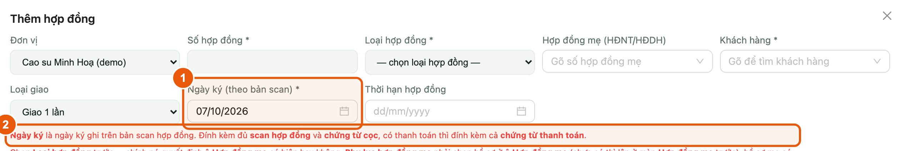

*Hình 1. Ô Ngày ký và dòng nhắc chứng từ cần đính kèm*

1. Ô **Ngày ký (theo bản scan)**: chọn đúng ngày ký ghi trên bản scan hợp đồng, không lấy ngày nhập liệu.
2. Dòng chữ đỏ ngay bên dưới nhắc các bản scan cần đính kèm cho hợp đồng.

> Từ ngày ký, sản lượng hợp đồng bắt đầu nằm ở mục “HĐ đã bán chờ giao”. Ngày ký sai thì số này sai theo.

## 3. Nhập đặt cọc (nhiều đợt)

**Vị trí:** Phiếu Thêm / Sửa hợp đồng ▸ mục Đặt cọc

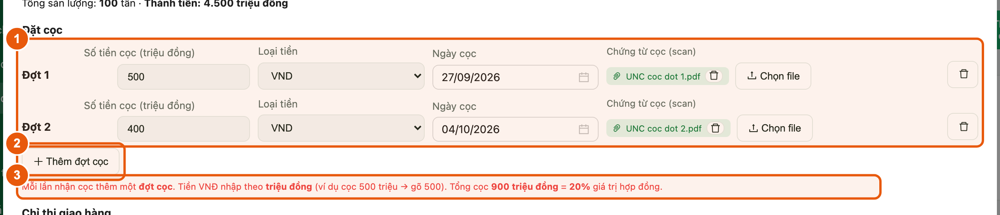

*Hình 2. Mục Đặt cọc — mỗi lần nhận cọc là một đợt*

1. Mỗi lần nhận cọc là một **đợt cọc**: nhập **Số tiền cọc**, **Loại tiền**, **Ngày cọc**, rồi bấm **Chọn file** để đính kèm chứng từ cọc (ủy nhiệm chi, giấy báo có…).
2. Bấm **Thêm đợt cọc** để thêm đợt tiếp theo. Nhập nhầm một đợt thì bấm biểu tượng thùng rác ở cuối dòng đó.
3. Đọc dòng chữ đỏ bên dưới: **tổng cọc** và bằng bao nhiêu % giá trị hợp đồng. Dùng để tự kiểm tra trước khi bấm **Lưu**.

> - Tiền VNĐ nhập theo **triệu đồng**: cọc 500 triệu thì gõ **500**. Cọc bằng USD thì nhập số USD.
> - Loại tiền tự lấy theo loại tiền của hợp đồng; cọc bằng loại tiền khác thì chọn lại.
> - Ngày cọc không được sau hôm nay.
> - Hợp đồng giao nhiều lần: đặt cọc nhập ở **hợp đồng**, không nhập ở từng đợt giao.

## 4. Khi tổng cọc lớn hơn giá trị hợp đồng

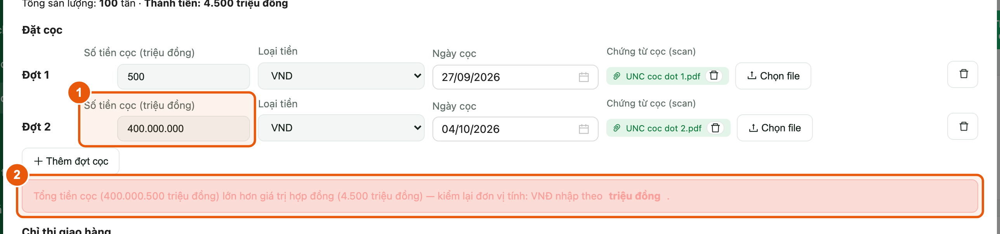

*Hình 3. Gõ số tiền theo đồng — hệ thống báo đỏ, không cho lưu*

1. Gõ số tiền theo **đồng** (ví dụ 400.000.000) thì tổng cọc lớn hơn giá trị hợp đồng.
2. Hệ thống báo đỏ và **không cho lưu**. Sửa lại theo triệu đồng (ví dụ **400**) rồi bấm **Lưu**.

## 5. Nhập chỉ thị giao hàng

**Vị trí:** Phiếu hợp đồng giao 1 lần, hoặc phiếu đợt giao ▸ mục Chỉ thị giao hàng

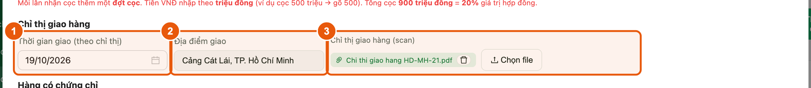

*Hình 4. Mục Chỉ thị giao hàng*

1. **Thời gian giao (theo chỉ thị)**: ngày giao ghi trên chỉ thị. Chọn được ngày sắp tới.
2. **Địa điểm giao**: ví dụ cảng hoặc kho giao hàng.
3. Bấm **Chọn file** để đính kèm bản scan chỉ thị giao hàng.

> - Hợp đồng **giao 1 lần**: nhập ngay trên phiếu hợp đồng.
> - Hợp đồng **giao nhiều lần**: mỗi chuyến một chỉ thị, nhập ở từng **đợt giao** (bấm **Xem** ở hợp đồng ▸ tab **Đợt giao** ▸ **Thêm đợt giao**). Hàng chưa giao thì để trống **Ngày giao**.

## 6. Chứng từ thanh toán và scan hợp đồng

**Vị trí:** Cuối phiếu Thêm / Sửa hợp đồng

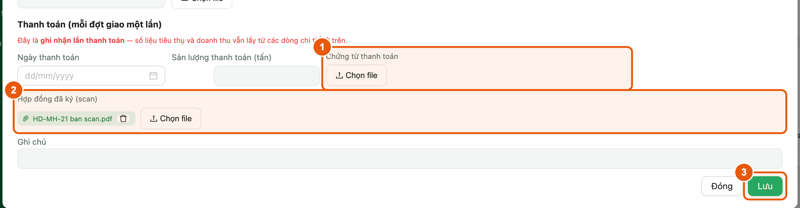

*Hình 5. Chứng từ thanh toán, scan hợp đồng và nút Lưu*

1. Khi khách đã thanh toán: ở mục **Thanh toán**, nhập ngày, sản lượng thanh toán và bấm **Chọn file** ở **Chứng từ thanh toán**.
2. **Hợp đồng đã ký (scan)**: đính kèm bản scan hợp đồng.
3. Bấm **Lưu**.

> Hợp đồng giao nhiều lần: thanh toán nhập ở từng **đợt giao**.

## 7. Tìm hợp đồng còn thiếu chứng từ và bổ sung

**Vị trí:** Menu ▸ Quản lý hợp đồng ▸ Hợp đồng & đợt giao

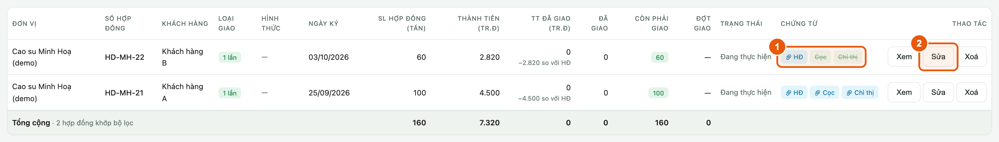

*Hình 6. Cột Chứng từ — chữ gạch ngang là còn thiếu*

1. Xem cột **Chứng từ**: **HĐ** (scan hợp đồng) · **Cọc** · **Chỉ thị** · **TT** (thanh toán, chỉ hiện khi hợp đồng giao 1 lần đã giao). Chữ **gạch ngang** là chưa đính kèm.
2. Bấm **Sửa** ở dòng còn thiếu, bổ sung theo mục 3, 5, 6 rồi bấm **Lưu**.

> - Dòng hiện **(chỉ xem)**: bấm **Đề nghị sửa**, bổ sung chứng từ rồi bấm **Gửi đề nghị sửa**. Hệ thống báo “Đã lưu trực tiếp” là xong, không phải chờ Ban duyệt.
> - Hợp đồng giao nhiều lần: chỉ thị giao hàng và thanh toán xem ở tab **Đợt giao** của hợp đồng.

## 8. Xem lại trên màn chi tiết hợp đồng

**Vị trí:** Menu ▸ Quản lý hợp đồng ▸ Hợp đồng & đợt giao ▸ bấm Xem ở dòng hợp đồng

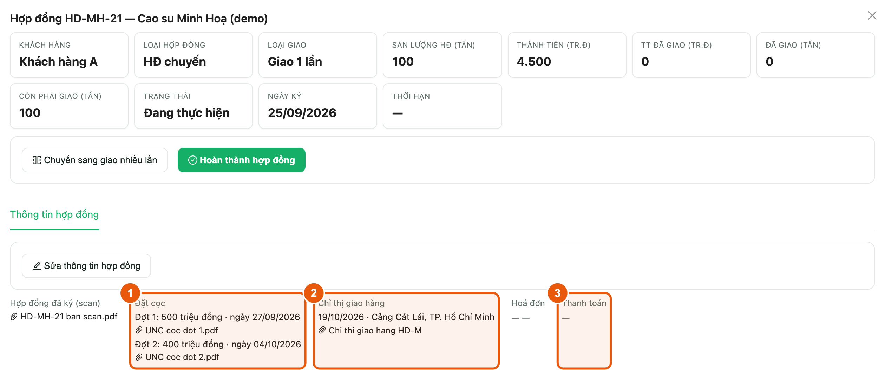

*Hình 7. Màn chi tiết — tab Thông tin hợp đồng*

1. **Đặt cọc**: từng đợt cọc kèm số tiền, ngày cọc và file.
2. **Chỉ thị giao hàng**: thời gian, địa điểm và file.
3. **Thanh toán**: ngày thanh toán và chứng từ. Bấm tên file để mở bản scan.

## 9. Nguồn tiêu thụ — chọn nguồn khi nhập lần giao

**Vị trí:** Menu ▸ Quản lý hợp đồng ▸ Hợp đồng & đợt giao

Mỗi dòng chủng loại của một lần giao phải ghi rõ nguồn: **Khai thác** (mủ vườn cây của đơn vị), **Thu mua** (mủ đơn vị mua vào) hoặc **Hàng hóa cao su** (thành phẩm mua ngoài về bán lại). Áp dụng cho phiếu **Thêm đợt giao** và phiếu hợp đồng **giao 1 lần**.

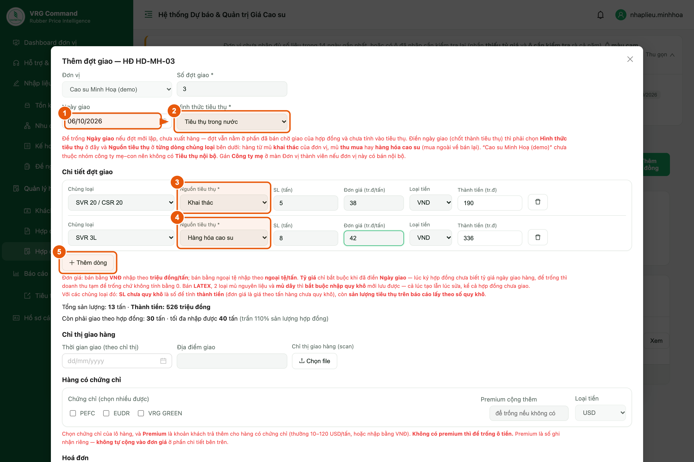

*Hình 8. Phiếu đợt giao — mỗi dòng chủng loại có ô Nguồn tiêu thụ*

1. Điền **Ngày giao** khi hàng đã giao xong.
2. Chọn **Hình thức tiêu thụ**.
3. Ở dòng chủng loại, chọn **Nguồn tiêu thụ**.
4. Có thêm chủng loại thì chọn nguồn cho từng dòng. Mỗi dòng có thể khác nguồn.
5. Bấm **Thêm dòng** để thêm chủng loại. Xong bấm **Lưu** ở cuối phiếu.

> - Đợt mới lập, chưa điền Ngày giao thì chưa cần chọn nguồn.
> - Hợp đồng giao nhiều lần: nguồn chọn ở từng **đợt giao**. Phần chi tiết của hợp đồng không có ô nguồn.

## 10. Khi quên chọn nguồn

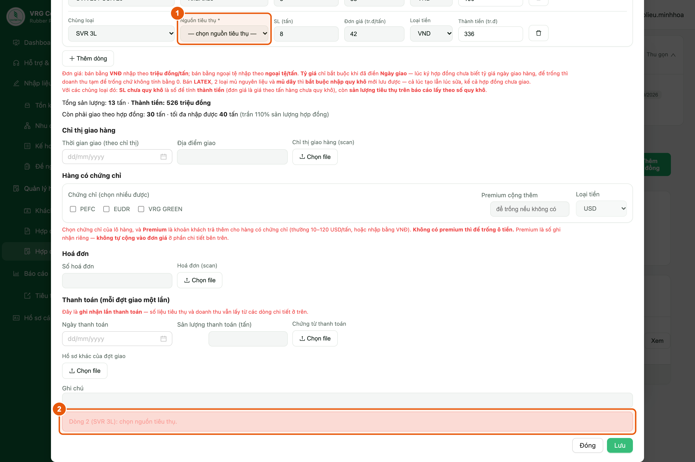

*Hình 9. Thiếu nguồn ở một dòng — hệ thống báo đúng dòng đó*

1. Dòng còn trống ô **Nguồn tiêu thụ** thì phiếu không lưu được.
2. Thông báo ở cuối phiếu ghi rõ dòng nào thiếu, ví dụ “Dòng 2 (SVR 3L): chọn nguồn tiêu thụ.”. Chọn nguồn cho dòng đó rồi bấm **Lưu** lại.

## 11. Sửa nguồn lần giao đã nhập — mở lần giao (đến hết 12/10/2026)

**Vị trí:** Menu ▸ Quản lý hợp đồng ▸ Hợp đồng & đợt giao ▸ Xem

Các lần giao nhập trước ngày 05/10/2026 được tạm ghi là **Khai thác**. Dòng nào không đúng thì sửa lại. Nút **Sửa nguồn** dùng được cả với lần giao đã khoá.

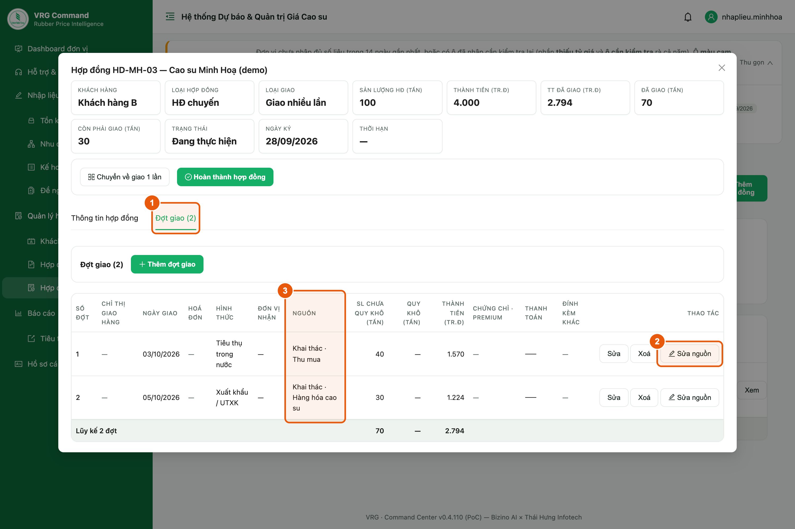

*Hình 10. Tab Đợt giao — nút Sửa nguồn và cột Nguồn*

1. Mở hợp đồng bằng nút **Xem**. Hợp đồng giao nhiều lần thì chọn tab **Đợt giao**.
2. Bấm **Sửa nguồn** ở lần giao cần sửa. Hợp đồng giao 1 lần thì nút nằm ở tab **Thông tin hợp đồng**.
3. Cột **Nguồn** cho biết lần giao đang tính nguồn nào, ví dụ “Khai thác · Thu mua”.

> - Nút **Sửa nguồn** chỉ có đến hết ngày **12/10/2026**. Sau đó, lần giao đã khoá phải gửi **Đề nghị sửa**.
> - Sửa nguồn không làm đổi sản lượng hay doanh thu, chỉ đổi cách chia theo nguồn.

## 12. Sửa nguồn — chọn nguồn từng dòng rồi lưu

**Vị trí:** Hộp «Sửa nguồn tiêu thụ»

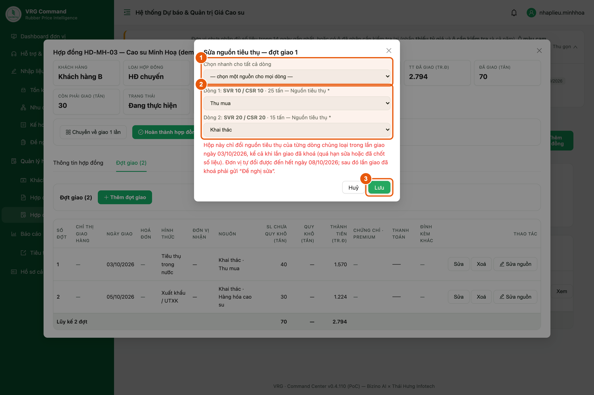

*Hình 11. Hộp Sửa nguồn tiêu thụ*

1. Cả lần giao cùng một nguồn: chọn ở ô **Chọn nhanh cho tất cả dòng**.
2. Các dòng khác nguồn nhau: chọn nguồn cho từng dòng.
3. Bấm **Lưu**. Cột **Nguồn** trong bảng đổi ngay.

## 13. Hoàn thành hợp đồng giao 1 lần chưa nhập ngày giao

**Vị trí:** Menu ▸ Quản lý hợp đồng ▸ Hợp đồng & đợt giao ▸ Xem ▸ Hoàn thành hợp đồng

Hoàn thành hợp đồng giao 1 lần chưa có ngày giao cũng là ghi nhận **đã giao**, nên màn hình hỏi thêm hình thức và nguồn của từng dòng.

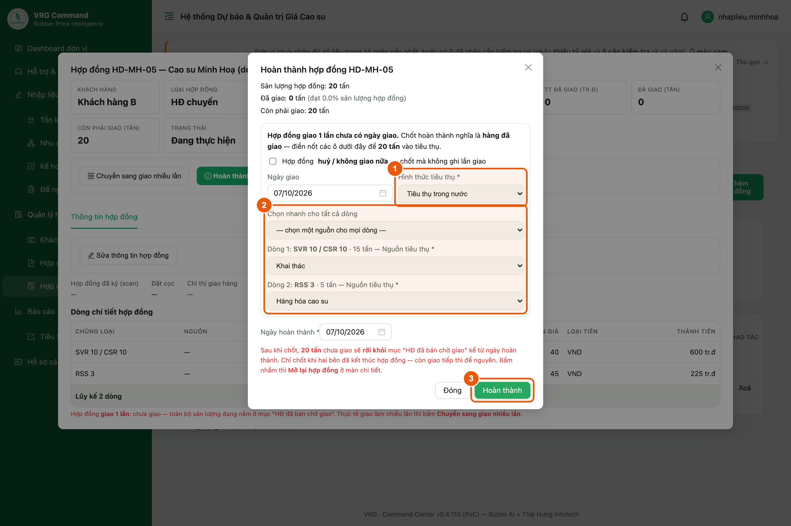

*Hình 12. Hoàn thành hợp đồng — chọn hình thức và nguồn từng dòng*

1. Chọn **Hình thức tiêu thụ**. Ô Ngày giao để sẵn bằng ngày hoàn thành, khác thì sửa lại.
2. Chọn **Nguồn tiêu thụ** cho từng dòng, hoặc dùng ô **Chọn nhanh cho tất cả dòng**.
3. Bấm **Hoàn thành**.

> Hợp đồng huỷ, không giao nữa thì tích ô **huỷ / không giao nữa**. Khi đó không cần chọn nguồn.

## 14. Xem tỷ trọng nguồn trên Dashboard đơn vị

**Vị trí:** Menu ▸ Dashboard đơn vị ▸ khối Tiêu thụ

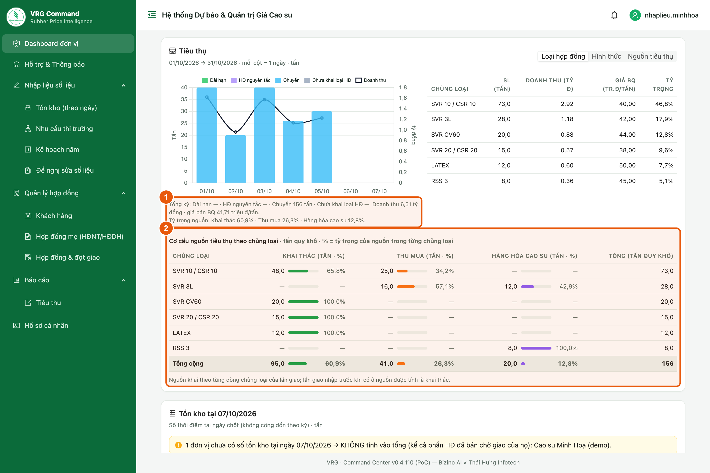

*Hình 13. Tỷ trọng nguồn và cơ cấu nguồn theo chủng loại*

1. Dòng **Tỷ trọng nguồn** dưới biểu đồ: cả kỳ bao nhiêu phần trăm từ mỗi nguồn.
2. Bảng **Cơ cấu nguồn tiêu thụ theo chủng loại**: mỗi chủng loại bao nhiêu tấn từ mỗi nguồn.

> Ở biểu đồ Tiêu thụ, chọn **Nguồn tiêu thụ** (góc trên bên phải) để xem từng ngày theo nguồn. Số tính bằng **tấn quy khô**.

## 15. Kế hoạch năm — rà chỉ tiêu trước khi chốt

**Vị trí:** Menu ▸ Nhập liệu số liệu ▸ Kế hoạch năm

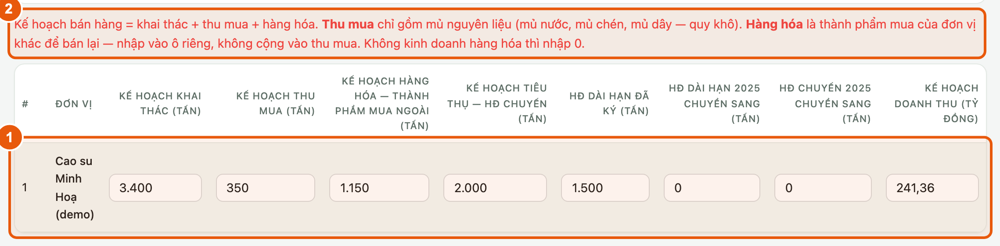

*Hình 14. Màn Kế hoạch năm của đơn vị*

1. Kiểm tra các ô kế hoạch năm của đơn vị: khai thác, thu mua, hàng hóa, tiêu thụ HĐ chuyến, HĐ dài hạn đã ký, phần năm trước chuyển sang và doanh thu. Số phải khớp kế hoạch được giao. Nhập hoặc sửa xong, bấm ra ngoài ô là tự lưu.
2. Đọc dòng nhắc đỏ: **Thu mua** chỉ gồm mủ nguyên liệu; **Hàng hóa** (thành phẩm mua ngoài) nhập ô riêng, không cộng vào thu mua. Không kinh doanh hàng hóa thì nhập 0.

> - Kế hoạch doanh thu nhập theo **tỷ đồng** (doanh thu 241,36 tỷ thì gõ 241,36). Các ô còn lại tính bằng **tấn**.
> - Ô bị mờ, không sửa được: kế hoạch đã chốt — xem mục 18.

## 16. Khi Ban TTKD yêu cầu chốt số liệu

**Vị trí:** Đầu mọi màn hình (hàng Yêu cầu chốt số liệu)

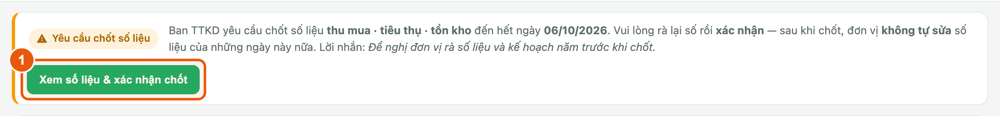

*Hình 15. Hàng Yêu cầu chốt số liệu*

1. Đầu mọi màn hình hiện hàng **Yêu cầu chốt số liệu** kèm ngày chốt và lời nhắn của Ban. Bấm **Xem số liệu & xác nhận chốt**.

## 17. Xác nhận kế hoạch năm cùng lúc chốt số liệu

**Vị trí:** Bảng «Số liệu chốt đến hết ngày …»

Bảng xác nhận gồm Thu mua, Tồn kho, Tiêu thụ và cuối cùng là khối **Kế hoạch năm (chốt cùng đợt)**.

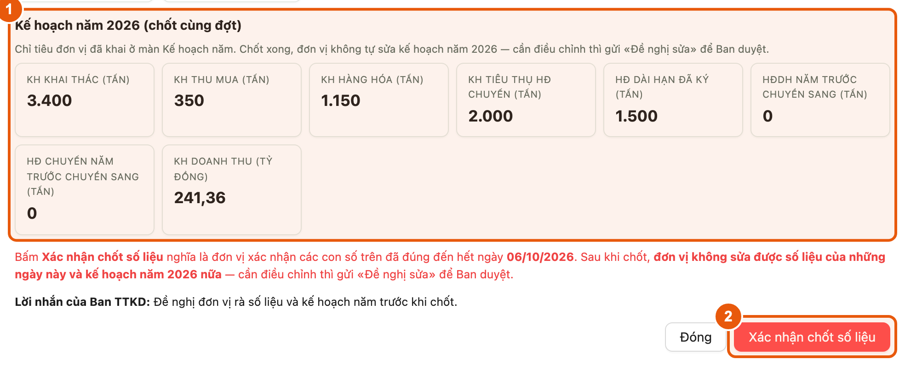

*Hình 16. Khối Kế hoạch năm trong bảng xác nhận chốt số liệu*

1. Kiểm tra khối **Kế hoạch năm (chốt cùng đợt)**. Số sai hoặc còn trống thì bấm **Đóng**, sửa ở màn Kế hoạch năm (mục 15) rồi mở lại bảng này.
2. Số liệu và kế hoạch đã đúng thì bấm **Xác nhận chốt số liệu**.

> - Bấm xác nhận là đơn vị xác nhận luôn **kế hoạch năm** — đây là kế hoạch dùng để so sánh với số thực hiện.
> - Bảng báo còn ngày chưa nộp thì nên nhập bù trước rồi mới chốt: chốt xong đơn vị không tự nhập bù được nữa.

## 18. Sau khi chốt: muốn sửa kế hoạch năm

**Vị trí:** Menu ▸ Nhập liệu số liệu ▸ Kế hoạch năm

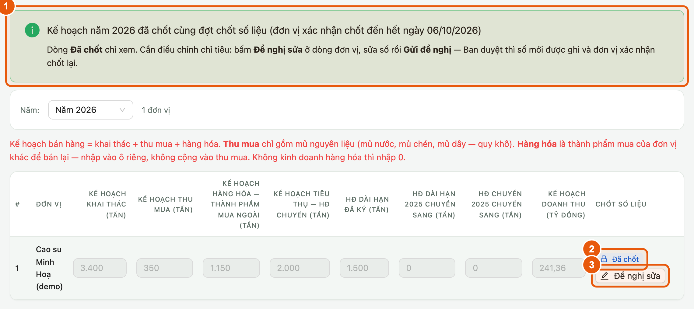

*Hình 17. Kế hoạch năm đã chốt — chỉ xem, sửa qua Đề nghị sửa*

1. Đầu màn hiện thông báo kế hoạch năm **đã chốt cùng đợt chốt số liệu**. Các ô kế hoạch chỉ xem.
2. Cột **Chốt số liệu** hiện **Đã chốt**.
3. Cần điều chỉnh: bấm **Đề nghị sửa**, sửa số trên dòng rồi bấm **Gửi đề nghị**. Ban duyệt xong, số mới được ghi và đơn vị xác nhận chốt lại.

> Theo dõi đề nghị đã gửi ở **Menu ▸ Nhập liệu số liệu ▸ Đề nghị sửa số liệu**.
